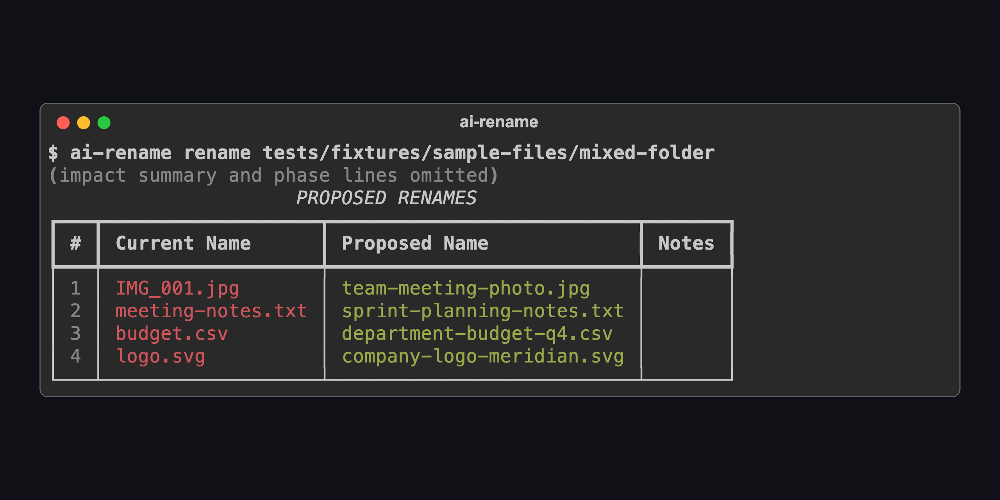

# ai-file-rename

[](LICENSE)
[](tests/)
[](pyproject.toml)
[](AGENTS.md)

Rename files by their content, a whole folder at a time: a Gemini CLI that dry-runs by default and can undo.



*The dry-run table for [`tests/fixtures/sample-files/mixed-folder`](tests/fixtures/sample-files/mixed-folder), with the names from the naming response recorded for it in [`holistic_naming_mixed.json`](tests/fixtures/mock-responses/holistic_naming_mixed.json). Rendered from the fixture by [`render_hero.py`](docs/assets/render_hero.py), not from a live call, so you can check every cell.*

- **Reads the content, not the filename.** Text, PDFs, Office documents, images, audio and video go to Gemini; 69 file extensions are read (20 natively, 11 after conversion, 38 as text) and 32 kinds are refused by design, so `program.exe` is never renamed by guesswork. The table is [`constants.py`](src/ai_file_rename/constants.py).
- **Names a folder as a set, not file by file.** One call reads each file, then the folder is named together (one call up to 50 files, batched above that), so `IMG_001.jpg`, `budget.csv` and `meeting-notes.txt` come out as a coherent family instead of three unrelated guesses.
- **Nothing moves without a record.** Dry run is the default, every executed rename is written to a manifest before the `mv`, name collisions are resolved before anything moves, and symlinks that pointed at a renamed file are updated. `ai-rename undo` reverses a run that was interrupted or had failures; a clean run is logged to `~/.ai-rename/logs/rename-history.jsonl`.

## What it does

A folder in, a plan out, a record left behind. With `-d -H -P` (dry run, no prompts, plain text) the same table prints for scripts and agents; this is the fixture above, in that format:

```text
$ ai-rename rename tests/fixtures/sample-files/mixed-folder -d -H -P
(impact summary and phase lines omitted)
[PROPOSED RENAMES] count=4
    1. [rename] IMG_001.jpg -> team-meeting-photo.jpg
    2. [rename] meeting-notes.txt -> sprint-planning-notes.txt
    3. [rename] budget.csv -> department-budget-q4.csv
    4. [rename] logo.svg -> company-logo-meridian.svg
```

Every run, dry or not, writes `.ai-rename-report-<run_id>.md` into the folder with the table, the token count and the cost. With `-x` the plan is executed and `.ai-rename-manifest.json` records each move until the run completes. The manifest shape and lifecycle are in [`manifest.py`](src/ai_file_rename/manifest.py); the report writer is `RunReport` in [`cli.py`](src/ai_file_rename/cli.py).

## Quickstart

```bash
uv tool install "ai-file-rename[full] @ git+https://github.com/saif-raja/ai-file-rename"
export GEMINI_API_KEY="..."            # free key: https://aistudio.google.com/app/apikey
ai-rename rename ~/Downloads/messy     # dry run: shows the plan, renames nothing
```

Then `ai-rename rename ~/Downloads/messy -x` to apply it. Every flag, the YAML config, cost limits and the headless mode for scripts and agents are in the [operations manual](docs/2-operations-manual.md); agents start at [`AGENTS.md`](AGENTS.md).

## From Python

The CLI is a thin wrapper over one class ([`session.py`](src/ai_file_rename/session.py)):

```python
from ai_file_rename import RenameSession

session = RenameSession(target_dir="tests/fixtures/sample-files/mixed-folder", api_key="...")
plan = session.analyze()                     # one Gemini call per file, then the naming call for the folder
for r in plan.validated_renames:
    print(r.original.current_name, "->", r.final_name)
# IMG_001.jpg -> team-meeting-photo.jpg      (the four lines of the fixture response above;
# meeting-notes.txt -> sprint-planning-notes.txt   a live call returns whatever Gemini says today)
# budget.csv -> department-budget-q4.csv
# logo.svg -> company-logo-meridian.svg
result = session.execute(plan)               # renames, writes the manifest and the history log
```

## How it works

One module per stage, in the order a file passes through:

| Stage | Module | What it owns |
|---|---|---|
| 1 | [`discovery.py`](src/ai_file_rename/discovery.py) | Walks the folder, classifies every file, finds symlinks, estimates cost |
| 2 | [`metadata.py`](src/ai_file_rename/metadata.py), [`preprocessing.py`](src/ai_file_rename/preprocessing.py) | EXIF, document properties, audio tags; converts what Gemini cannot read natively, in a temp dir |
| 3 | [`analyzer.py`](src/ai_file_rename/analyzer.py) | The first Gemini call: one content summary per file |
| 4 | [`namer.py`](src/ai_file_rename/namer.py) | The naming call: the whole folder in one call up to 50 files, clustered, sampled or progressive batches above that |
| 5 | [`validator.py`](src/ai_file_rename/validator.py) | Cross-platform safe names, length limits, collision resolution; a pure function |
| 6 | [`executor.py`](src/ai_file_rename/executor.py), [`manifest.py`](src/ai_file_rename/manifest.py) | Record intent, rename, verify, record success; the manifest is what `undo` reads |

The decisions behind that shape (why two calls, why a manifest and not a database, why symlinks are updated rather than skipped) are in the [architecture note](docs/0-architecture.md) and the [PRD](docs/0-PRD.md), both written at design time; where they and the code differ, the code is right.

## Status

Works as is; fixed forward. What is open, including the limits of `undo`, is in [`docs/1-known-issues.md`](docs/1-known-issues.md). Bugs go to [Issues](https://github.com/saif-raja/ai-file-rename/issues), questions to [Discussions](https://github.com/saif-raja/ai-file-rename/discussions).

---

Built by [Saif Raja](https://github.com/saif-raja), one person and a coding agent. If a folder of yours comes out badly named, open an issue with the file set that broke it (names and types are enough) and I will look.
